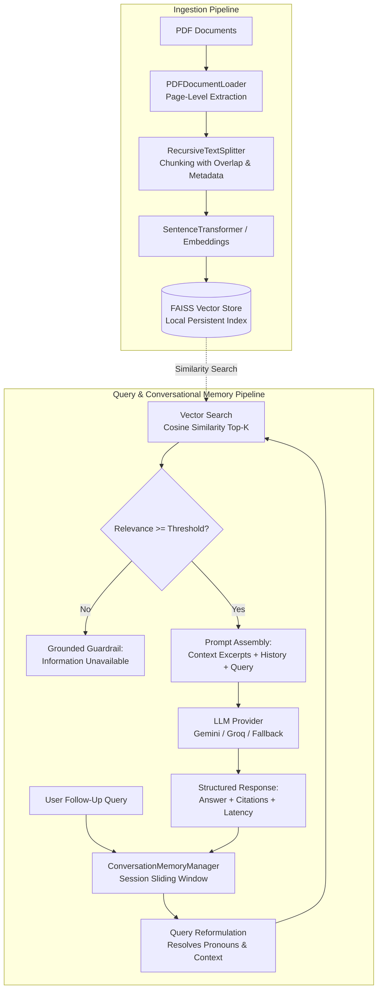

# Intelligent Multi-Document Conversational RAG System

[](https://www.python.org/)
[](https://fastapi.tiangolo.com/)
[](https://github.com/facebookresearch/faiss)
[](https://docs.pydantic.dev/)
[](https://streamlit.io/)

An enterprise-ready **Retrieval-Augmented Generation (RAG)** platform designed to ingest collections of heterogenous PDF documents, maintain stateful multi-turn conversational memory, resolve contextual pronouns across follow-up queries, and synthesize strictly grounded answers with verifiable source citations.

---

## 📌 Problem Statement & Objectives

Modern enterprises maintain vast repositories of mission-critical documents—ranging from financial reports and compliance manuals to cloud architecture specifications. Manually parsing and cross-referencing information across these documents is slow, error-prone, and inefficient.

This system delivers an end-to-end intelligent assistant that:
1. **Multi-Document Ingestion:** Processes multiple complex PDF reports simultaneously while preserving document provenance and 1-indexed page numbering.
2. **Context-Aware Retrieval:** Employs recursive chunking with boundary overlap and local vector embeddings (`sentence-transformers/all-MiniLM-L6-v2`) indexed via **FAISS**.
3. **Conversational Memory:** Preserves multi-turn dialogue history per session, dynamically reformulating ambiguous follow-up questions (e.g., *"How does that compare to Q2?"*) into self-contained search queries.
4. **Strict Grounding & Hallucination Guardrail:** Strictly conditions LLM synthesis on retrieved passages. If requested information is absent from the documents, it explicitly returns an unavailable notice rather than hallucinating.
5. **Precise Citations:** Every synthesized claim is attributed to its source document, page number, relevance score, and verifiable text snippet.

---

## 🏗️ System Architecture



---

## 📂 Project Structure

```
multidoc-conversational-rag/
├── app/
│   ├── __init__.py
│   ├── main.py                     # FastAPI application factory & lifespan manager
│   ├── config.py                   # Centralized application settings & path resolution
│   ├── api/
│   │   ├── __init__.py
│   │   └── routes.py               # REST endpoints (/upload, /chat, /history, /documents)
│   ├── core/
│   │   ├── __init__.py
│   │   ├── pdf_loader.py           # Robust PyPDF extractor with page metadata
│   │   ├── text_splitter.py        # Recursive semantic chunker with boundary overlap
│   │   ├── vector_store.py         # FAISS vector store manager & disk persistence
│   │   ├── memory.py               # Session-based conversational memory manager
│   │   └── rag_engine.py           # Full RAG query lifecycle, grounding, and citations
│   └── models/
│       ├── __init__.py
│       └── schemas.py              # Pydantic v2 schemas & API contracts
├── data/
│   ├── sample_docs/                # Pre-bundled PDF datasets for instant evaluation
│   │   ├── acme_financial_annual_report_2025.pdf
│   │   ├── cloudscale_technical_architecture_manual.pdf
│   │   └── apex_global_hr_and_operational_policy.pdf
│   └── faiss_index/                # Persistent vector storage directory
├── frontend/
│   └── streamlit_app.py            # Modern interactive web UI with citation cards
├── tests/
│   ├── __init__.py
│   └── test_rag_pipeline.py        # Pytest test suite (ingestion, retrieval, memory, guardrails)
├── generate_sample_pdfs.py         # Reproducible script to generate sample domain PDFs
├── run_server.py                   # CLI entry point to launch FastAPI uvicorn server
├── requirements.txt                # Production Python dependencies
├── .env.example                    # Template for environment configuration
└── .gitignore                      # Standard Python & OS ignore rules
```

---

## 📑 Included Sample Documents (Dataset)

The project includes 3 multi-page, realistic domain reports located in `data/sample_docs/`:

| Document Name | Domain | Pages | Key Information Covered |
| :--- | :--- | :---: | :--- |
| **`acme_financial_annual_report_2025.pdf`** | Finance / SaaS | 3 | Full-year revenue ($485.4M), Net Income ($72.8M), segment breakdown (Enterprise SaaS, Cloud AI), regional splits, R&D expenditures. |
| **`cloudscale_technical_architecture_manual.pdf`** | Tech Infrastructure | 3 | Kubernetes EKS microservices, Istio mTLS, Aurora PostgreSQL, Redis caching, FAISS vector pipeline, SOC 2 / HIPAA compliance, RTO/RPO targets. |
| **`apex_global_hr_and_operational_policy.pdf`** | Operations / HR | 3 | Hybrid work model (2 days office, 3 days remote), Paid Annual Leave (24 days), parental leave (26 weeks maternity, 4 weeks paternity), $1,500 learning budget. |

*(These PDFs can be regenerated at any time using `python generate_sample_pdfs.py`)*

---

## 🚀 Quickstart & Installation

### 1. Clone the Repository
```bash
git clone https://github.com/Akshat9151/multidoc-conversational-rag.git
cd multidoc-conversational-rag
```

### 2. Set Up Virtual Environment
```bash
# Windows
python -m venv venv
.\venv\Scripts\activate

# macOS / Linux
python3 -m venv venv
source venv/bin/activate
```

### 3. Install Dependencies
```bash
pip install -r requirements.txt
```

### 4. Configure Environment Variables
Copy `.env.example` to `.env`:
```bash
cp .env.example .env
```
Open `.env` and set your preferred LLM provider and API key:
```ini
LLM_PROVIDER=gemini
GEMINI_API_KEY=your_actual_gemini_api_key_here
```
*(Note: If no API key is configured, the system gracefully engages its built-in extractive synthesis engine for offline testing without crashing).*

---

## 🖥️ Running the Application

### Option A: Launch FastAPI REST API & Swagger UI
```bash
python run_server.py
```
* **Interactive API Documentation (Swagger):** [http://localhost:8000/docs](http://localhost:8000/docs)
* **Alternative Redoc Documentation:** [http://localhost:8000/redoc](http://localhost:8000/redoc)

### Option B: Launch Interactive Web UI (Streamlit)
```bash
streamlit run frontend/streamlit_app.py
```
Access the application in your browser at `http://localhost:8501`.

---

## 📡 REST API Reference

| Method | Endpoint | Description |
| :--- | :--- | :--- |
| `POST` | `/api/v1/documents/upload` | Upload and index multiple PDF files via `multipart/form-data`. |
| `POST` | `/api/v1/documents/index-samples` | One-click ingestion of pre-bundled sample PDFs in `data/sample_docs/`. |
| `POST` | `/api/v1/chat` | Send question; returns grounded answer, citations, and session state. |
| `GET` | `/api/v1/chat/history/{session_id}` | Retrieve full conversational history transcript for a session. |
| `DELETE` | `/api/v1/chat/session/{session_id}` | Reset and clear conversation memory for a session. |
| `GET` | `/api/v1/documents` | List all currently indexed documents, page counts, and total chunks. |
| `GET` | `/api/v1/health` | Service health status, active index metrics, and embedding model info. |

### Sample Chat Request:
```bash
curl -X POST "http://localhost:8000/api/v1/chat" \
     -H "Content-Type: application/json" \
     -d '{
       "question": "What was Acme Global Technologies revenue for FY2025 and how much did Cloud AI contribute?",
       "session_id": "session_demo_01",
       "top_k": 4
     }'
```

### Sample Response with Citations:
```json
{
  "answer": "Acme Global Technologies reported consolidated revenue of $485.4 million for FY2025, an increase of 28.5% year-over-year (Source: acme_financial_annual_report_2025.pdf, Page 1). The Cloud AI Infrastructure division contributed $125.0 million, representing 25.8% of total revenue (Source: acme_financial_annual_report_2025.pdf, Page 2).",
  "session_id": "session_demo_01",
  "grounded": true,
  "citations": [
    {
      "document_name": "acme_financial_annual_report_2025.pdf",
      "page_number": 1,
      "snippet": "Consolidated full-year revenue reached $485.4 million, representing a 28.5% year-over-year increase compared to $377.7 million in fiscal year 2024...",
      "relevance_score": 0.892
    },
    {
      "document_name": "acme_financial_annual_report_2025.pdf",
      "page_number": 2,
      "snippet": "Cloud AI Infrastructure revenue grew by 74.2% year-over-year to $125.0 million (25.8% of total revenue)...",
      "relevance_score": 0.841
    }
  ],
  "rewritten_query": null,
  "latency_ms": 184.25
}
```

---

## 💬 Verification of Conversational Memory

### Multi-Turn Dialogue Walkthrough:
* **Turn 1 (User):** *"What is the annual learning budget at Apex Global?"*
  - **Assistant:** *"Apex Global provides an individual Professional Learning Budget of $1,500 per fiscal year for full-time employees (Source: apex_global_hr_and_operational_policy.pdf, Page 3)."*
* **Turn 2 (User Follow-up):** *"What does it cover?"*
  - **Query Reformulation:** System detects referential pronoun *"it"* and rewrites query to: *"What does the Apex Global individual Professional Learning Budget cover?"*
  - **Assistant:** *"It covers approved technical certifications (e.g. AWS, GCP, CKA, AI-ML credentials), university coursework, industry conference registrations, and technical book purchases (Source: apex_global_hr_and_operational_policy.pdf, Page 3)."*

### Verification of Unavailable Information Guardrail:
* **User Question:** *"What are the safety guidelines for operating nuclear reactors on site?"*
  - **Assistant:** *"Based on the uploaded documents, I could not find information regarding safety guidelines for operating nuclear reactors on site."*
  - **System Behavior:** `grounded: false`, empty citation list, zero hallucinations.

---

## 🧪 Running Automated Tests

Run the full automated test suite using `pytest`:
```bash
pytest tests/ -v
```

Tests validate:
1. Multi-page PDF text extraction and metadata integrity.
2. Recursive semantic chunking and chunk overlap consistency.
3. FAISS vector storage indexing and cosine similarity score ranking.
4. Session-based sliding window conversational memory.
5. Grounded synthesis vs. anti-hallucination guardrail triggers.

---

## 📄 License
This project is released under the **MIT License**.
